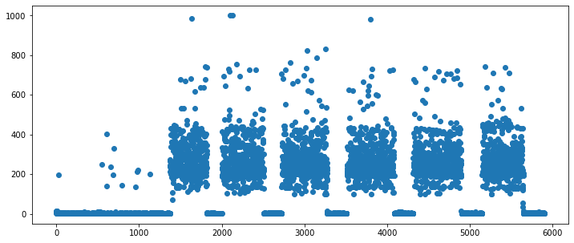
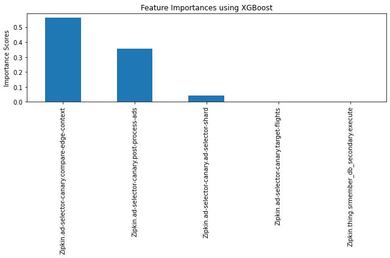
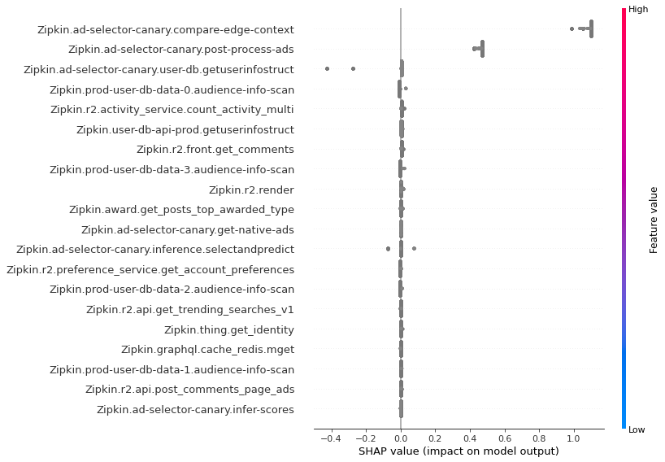
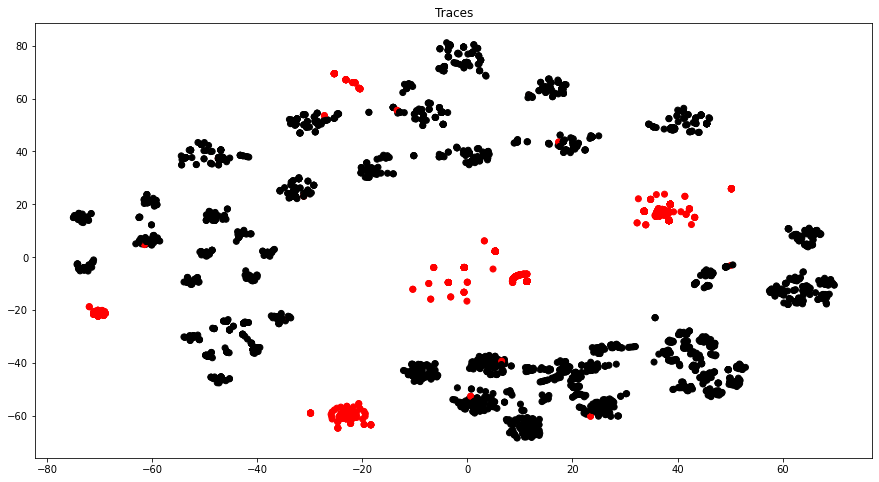

# Explainable Root Cause Analysis for Cloud Applications

**Which parts of a cloud application are linked to failed requests, and can explainable AI point engineers to them?**

*Industry project with VMware, 2022*

**Tools:** Python, pandas, scikit-learn, XGBoost, SHAP, t-SNE, Weka (RIPPER)

**[Open the full analysis notebook](cloud_analytics.ipynb)** · [view on nbviewer](https://nbviewer.org/github/lilitpghs/cloud-root-cause-analysis/blob/main/cloud_analytics.ipynb)

---

## The problem

Modern cloud applications are built from dozens of small services. One user request can pass through many of them, and when it fails, the error often shows up far from where the problem started. Engineers then have to read through hundreds of operations per request to find the cause.

This project asks: **can a model learn which parts of the application are associated with failed requests, and can explainable AI make that visible so engineers know where to look first?**

## The data

- **5,899 request traces** from a microservice application, collected with distributed tracing (Zipkin)
- Each trace is a list of **spans**: one span is one operation in one service, with its host, duration and annotations
- **2,754 traces (47%) contain an error**, so the two classes are close to balanced

The data is confidential and is not included in this repository.



*Traces vary from a handful of spans to almost 1,000, so each one has to be turned into a fixed set of columns before modelling.*

## Approach

1. **Label** each trace as failed if any of its spans carries an error flag.
2. **Describe each trace in three ways,** from simple to detailed:
   - which operations appear (199 columns after cleaning)
   - how many times each operation appears
   - full span details: host, duration and annotations (2,168 columns after cleaning)
3. **Train gradient-boosted tree models** (XGBoost and HistGradientBoosting) to separate failed from successful traces, tuned with 5-fold cross-validation and tested on 25% of traces held out from training.
4. **Explain the models with three methods**: built-in feature importance, permutation importance and SHAP. Weka's RIPPER algorithm was used in addition to learn simple IF–THEN rules.
5. **Visualise the traces with t-SNE** to see whether failed traces look alike.

## Key findings

| | Finding |
|---|---|
| **Failures are highly predictable** | Every model separates failed and successful traces with about **99–100% precision and recall** on held-out traces, with almost no gap between training and test scores. |
| **That is a finding, not a trick** | Failures are concentrated in a handful of operations, so their presence almost decides whether a request fails. |
| **Every method points to the same place** | All data versions, both algorithms and all three explanation methods highlight a small group of operations in the **ad-selector service**: `compare-edge-context`, `post-process-ads` and its `user-db.getuserinfostruct` call. |
| **Failures follow a few patterns** | On the t-SNE map, failed traces form a few tight, separate clusters rather than spreading randomly. |



*Two operations in the ad-selector service account for more than 90% of the XGBoost model's decisions.*



*SHAP confirms it: `compare-edge-context` and `post-process-ads` push traces towards "failed" far more than any other operation.*



*Red = failed, black = successful. Failed traces cluster tightly, which suggests a few specific failure patterns.*

## Results across all models

| Model | What the model sees | Precision / recall | Top signal |
|:--|:--|:--|:--|
| A | Which operations appear | 1.00 / 0.99 | compare-edge-context, post-process-ads |
| B | How often each operation appears | 1.00 / 1.00 | user-db lookup |
| C | Full span details | 1.00 / 0.99 | compare-edge-context, post-process-ads |
| D | Full details + how often | 1.00 / 1.00 | user-db lookup |

*Precision and recall are for failed traces, measured on test traces the model never saw. Removing durations from C and D gave the same results. All top signals belong to the ad-selector service.*

**The key point is the agreement.** Four ways of describing the data, two algorithms and three explanation methods all point to the same few operations in the ad-selector service. One model can be misleading, but this level of agreement is a strong lead.

## Recommendations

1. **Start incident investigations in the ad-selector service**, specifically `compare-edge-context`, `post-process-ads` and its user-db calls.
2. **Check the canary release.** The service name contains *canary*, which usually means a new version tested on a small share of traffic. If failures cluster there, the new release is the first thing to check.
3. **Look at the user-db call pattern.** Repetition counts and durations of `getuserinfostruct` matter in the richer models, which can point to retries or slow lookups.
4. **Use the pipeline as a triage tool** to rank the operations most associated with a new batch of failures, instead of reading traces by hand.

## Limitations

- **Association, not cause.** The models show where failures are concentrated, not why they happen. The leads need to be confirmed by engineers.
- **The label comes from the same traces.** A trace is failed if one of its spans is flagged, so the model partly learns where errors are recorded. That is useful for locating problems and also explains the near-perfect scores.
- **One snapshot of one application.** Results may not hold for other periods, services or releases.
- **Not reproducible from this repository.** The data is confidential, and the notebook was run interactively in 2022. The code is shared so the method is transparent.

## Repository structure

```text
├── cloud_analytics.ipynb   # Full analysis with explanations and original outputs
├── figures/                # Key charts used in this README
├── requirements.txt        # Libraries imported in the notebook
└── README.md
```
